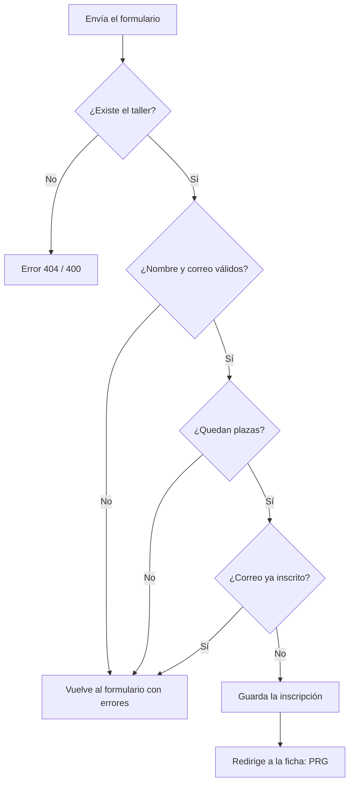

# 🎓 Inscripción a talleres

Aplicación web para consultar los talleres de unas jornadas tecnológicas y apuntarse a ellos. Hecha con **Node.js**, **Express** y **EJS**.

> 💾 Los datos se guardan en memoria: al parar el servidor se reinician.

🤖 **Chat de apoyo:** <PEGAR AQUÍ EL ENLACE AL CHAT>

---

## 🚀 Cómo arrancarla

```bash
npm install
npm start
```

Después abre 👉 `http://localhost:3000`

---

## 📁 Qué hay en el proyecto

| Fichero | Para qué sirve |
|---|---|
| `js/app.js` | 🧑‍🍳 El servidor: guarda los datos, tiene las rutas y decide qué responder |
| `js/talleres.js` | 🧮 Las funciones que calculan y validan (no saben nada del navegador) |
| `views/` | 🖼️ Las páginas que ve el usuario (listado, ficha, inscripción y error) |

---

## 🧠 La idea en 30 segundos

- Hay **dos listas** en memoria: talleres e inscripciones.
- Las plazas que quedan **no se guardan, se calculan**:
  `plazas restantes = plazas del taller − inscripciones de ese taller`
- Cada ficha tiene uno de **tres estados**:

| Estado | Cuándo | Qué se ve |
|---|---|---|
| 🟢 Disponible | Quedan 2 o más plazas | "N plazas disponibles" |
| 🟡 Última plaza | Queda 1 | "Última plaza disponible" |
| 🔴 Completo | Quedan 0 | "Completo" |

---

## 🗺️ Rutas

| Método | Ruta | Qué hace |
|---|---|---|
| GET | `/talleres` | Lista los talleres (con filtros opcionales) |
| GET | `/talleres/:id` | Ficha de un taller |
| GET | `/talleres/:id/inscripcion` | Muestra el formulario |
| POST | `/talleres/:id/inscripcion` | Procesa la inscripción |

---

## 🔄 Qué pasa cuando alguien se inscribe



Cuando hay un fallo, el formulario se muestra otra vez **con lo que estaba bien ya escrito** y los mensajes de error.

---

## ✨ Funcionalidades

### 1️⃣ Listado de talleres

La página `/talleres` coge todos los talleres y calcula las plazas que quedan de cada uno.

```bash
curl http://localhost:3000/talleres
```

🖱️ **En la web:** enlace "Talleres" del menú.

---

### 2️⃣ Filtros

Se pueden filtrar por **categoría**, **nivel** y **disponibilidad**, y combinar los tres a la vez. El servidor lee los filtros de la dirección y se queda solo con los talleres que los cumplen.

```bash
curl "http://localhost:3000/talleres?categoria=web"
curl "http://localhost:3000/talleres?nivel=avanzado"
curl "http://localhost:3000/talleres?disponibles=true"
curl "http://localhost:3000/talleres?categoria=web&nivel=avanzado&disponibles=true"
```

🖱️ **En la web:** formulario de filtros en el listado, con dos desplegables y una casilla "Solo con plazas".

---

### 3️⃣ Ficha del taller

`/talleres/:id` busca el taller por su número y enseña sus datos. El mensaje cambia según las plazas que queden (los tres estados de arriba).

```bash
curl http://localhost:3000/talleres/1   # 🟢 plazas disponibles
curl http://localhost:3000/talleres/2   # 🟡 última plaza
curl http://localhost:3000/talleres/3   # 🔴 completo
```

🖱️ **En la web:** enlace "Ver ficha" en cada taller del listado.

---

### 4️⃣ Formulario de inscripción

Comprueba que el taller existe y muestra el formulario con nombre y correo. Si el taller está completo, avisa en lugar de mostrarlo.

```bash
curl http://localhost:3000/talleres/1/inscripcion
```

🖱️ **En la web:** botón "Inscribirme" en la ficha.

---

### 5️⃣ Inscribirse

El formulario envía nombre y correo. Si todo está bien, el servidor guarda la inscripción y **redirige a la ficha** (patrón PRG), para que recargar la página no repita la inscripción.

```bash
curl -i -X POST \
  --data-urlencode "nombre=Ana López" \
  --data-urlencode "email=ana@example.com" \
  http://localhost:3000/talleres/1/inscripcion
```

> 💡 Con `-i` se ve la respuesta `303` y la cabecera `Location`, que es la redirección.

🖱️ **En la web:** el formulario de inscripción (botón "Inscribirme").

---

### 6️⃣ Validaciones y errores

El servidor comprueba, por este orden:

- ✅ que el taller existe
- ✅ que el nombre y el correo son válidos
- ✅ que quedan plazas
- ✅ que ese correo no está ya inscrito en ese taller
- ✅ que un número manipulado en la dirección no rompe nada

Todo lo que llega del navegador se trata como **no fiable**: del formulario solo se leen `nombre` y `email`, y el número del taller tiene que ser un entero positivo.

| Caso | Resultado |
|---|---|
| Número manipulado (`abc`, `-1`, `1.5`) | Error **400** |
| Taller que no existe | Error **404** |
| Datos mal, correo repetido o taller completo | Formulario con errores |

```bash
# ❌ datos inválidos
curl -X POST --data-urlencode "nombre=" --data-urlencode "email=mal" \
  http://localhost:3000/talleres/1/inscripcion

# ❌ correo ya inscrito
curl -X POST --data-urlencode "nombre=Curro" --data-urlencode "email=currox@example.com" \
  http://localhost:3000/talleres/1/inscripcion

# ❌ taller completo
curl -X POST --data-urlencode "nombre=Ana" --data-urlencode "email=ana@example.com" \
  http://localhost:3000/talleres/3/inscripcion

# ❌ taller inexistente y número manipulado
curl -i http://localhost:3000/talleres/999
curl -i http://localhost:3000/talleres/abc
```

🖱️ **En la web:** el mismo formulario del punto 5 para los errores de datos, y enlaces de prueba a `/talleres/999` y `/talleres/abc` al pie del listado.